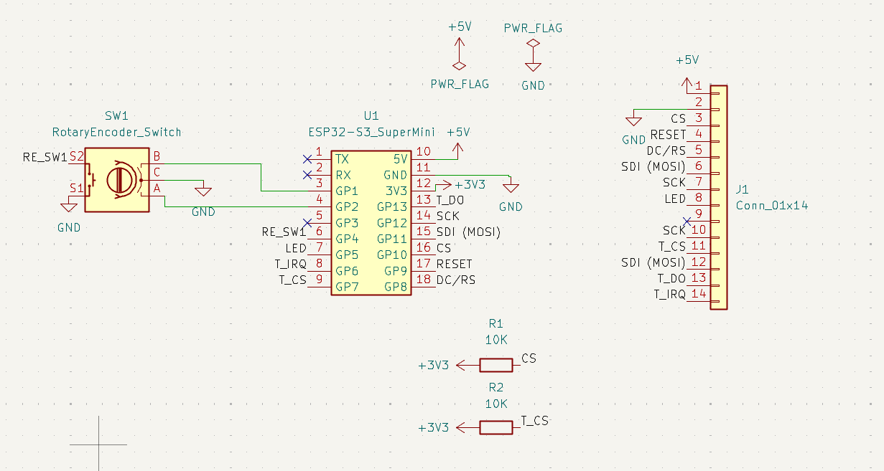
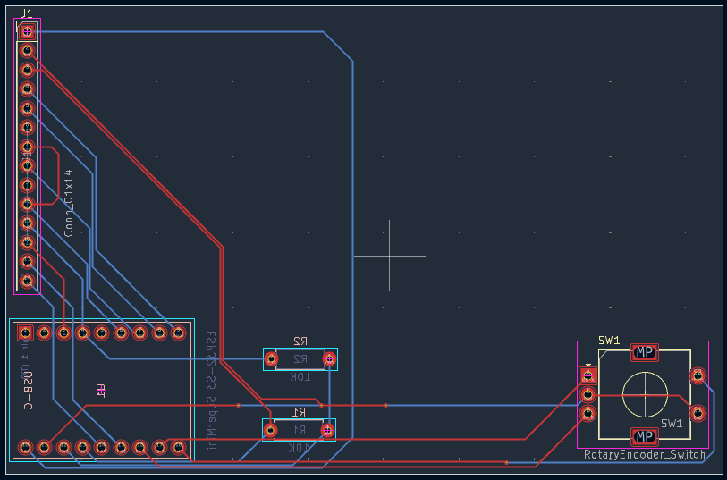
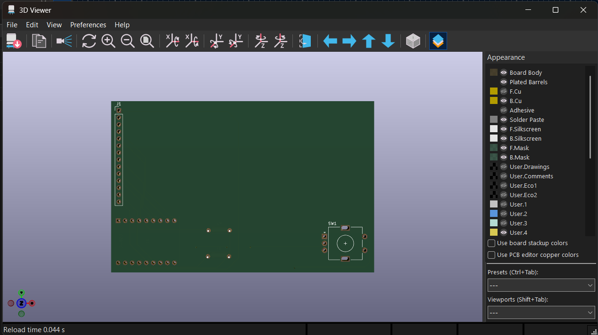
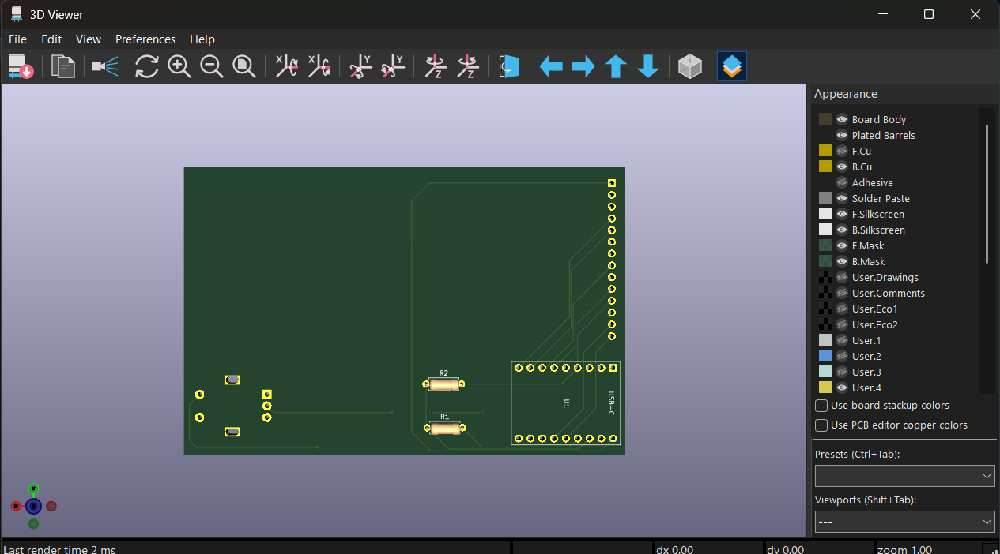

# MusicDisplay
A TFT touch screen music display that changes over bluetooth. Displays the current music playing and time.

## Description

The reason I wanted to build this is because, often when I listen to music while studying. If i ever want to change the 
music or adjust the volume, I get distracted looking at my phone. I also don't have headphones which can switch the music from
itself. So I wanted something where I can control the music and look at time and only important stuff, but I can't get distracted from something else.

## Features

* 3D Printed Case (TODO)
* TFT LCD Touch Screen for controls
* Interact with spotify over bluetooth
* EC11 Rorary Encoder for controlling volume
* USB-C connection for

## PCB

Custom PCB made in KiCad. Footprint for the ESP32 was built entirely by claude.

## Firmware

There is custom firmware for showing the current song, title, and artist. It shows the app name being used (ie. spotify) and time. Allows you to pause, play, forward, and reverse the song. It also shows the album picture and volume bar. It uses the knob 
to change the volumel, mute and unmute, and update the brightness of the screen. 

## BOM

## Thank You